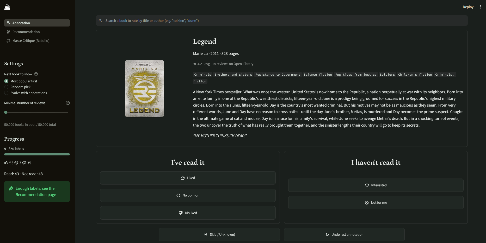

<p align="center">English | <a href="./README_fr.md">Français</a></p>


<h1 align="center">Babl</h1>

<p align="center">Babl is a <a href="https://streamlit.io/">Streamlit</a> app that provides personalised book recommendations</br>All running locally on your computer!</p>


<p align="center">
  <a href="https://github.com/zeon-studio/hugoplate/blob/main/LICENSE">
    
  </a>
  <a href="https://github.com/zeon-studio/hugoplate">
    
  </a>
</p>



## 👋 Context

Hi !

I started this project because I wanted to participate in [Babelio's Masse Critique events](https://www.babelio.com/massecritique.php), but didn't have the motivation to review every book of the event (200+ every month) to find out which one I might/might not like.

I wanted a tool that would rank those books according to my tastes so that I could make a choice quicker. And **Babl** does just that but I got a little involved and now... it is a real usable app!


## 🧙‍♂️ Features

- 🌗 Dark and light mode (obviously)
- 📚 A lightweight database of 50,000 pre-processed books
- 🏷️ An annotation tool to indicate which books you like/dislike with
    - 🎭 Actions: eead/not read - liked/not liked - skip - undo
    - 🔀 Different suggestion modes
    - 🔍 Search functionality
    - 📝 A form to add missing books
- 💡 A recommendation tool using [Open Library](https://openlibrary.org/)
    - 🪶 A lightweight machine learning model
    - 🏠 Runs locally (aka your data is yours)
    - 📈 Tons of graphs and help to understand the results
- 💡 A recommendation tool for [Babelio's Masse Critique events](https://www.babelio.com/massecritique.php)
    - 🎯 Semi-automatic fetching of books from the event
    - ❤️ Customised recommendations of books you should like


## 🚀 Getting Started
### Requirements

To use this project you must first install the following softwares on your machine:

- `git`: see [this tutorial](https://github.com/git-guides/install-git)
- `uv`: see [this other tutorial](https://docs.astral.sh/uv/getting-started/installation/)


### Installation

Open a terminal on your computer (type "powershell" in start menu for windows). In the terminal, paste and execute the following commands to copy this project on your machine:

```bash
git clone https://github.com/louisdalo/Babl.git
cd Babl
```
Then, in the same terminal, run the following command to launch the app:

```bash
uv run streamlit run app.py
```

Your browser should open automatically on the app, you are ready to go!

> [!WARNING]  
> When you launch the app for the first time, it will need to download and install a certain amount of packages. Do not change or close any windows until the download is complete!


### Tips

All your data lives in the `my_infos` subfolder.

If you want to edit/add/remove informations, this can all be done inside this subfolder. Deleting any file/folder in this subfolder *should* be safe, it will reset the deleted file when you launch the app on your next session.

## 🛠️ Advanced usage
If 50,000 books is not enough for you, then go to [openlibrary.org/developers/dumps](https://openlibrary.org/developers/dumps) and download the "all types" and "ratings" dumps (warning: they are several Go in size). Then, you can use `prepare_data.py` to generate your own dataset for this app.

Run this command for more details:
```bash
uv python prepare.py -h
```


## 🗺️ Roadmap
This lists known issues that I am currently working on, or features that I would like to add in the future:
- [ ] Create an interface to edit labels.
- [ ] French translation
    - [X] README.md
    - [ ] app UI
    - [ ] books metadata
- [ ] Better series grouping (unreliable because based on community tags):
    - [ ] manually detect Erin Hunter "warrior" series.

## 📞 Contact

Feel free to get in touch with any issues or suggestions for new features you'd like to see.

- 🐛 **Bug reports & issues:** Use [GitHub Issues](https://github.com/louisdalo/Babl/issues)

For anything else, contact me on [Bluesky](https://bsky.app/profile/louis-dalo.bsky.social)!


## ⚠️ Disclaimer

A significant proportion of this code was written with [claude.ai](https://claude.ai), [Anthropic](https://www.anthropic.com/)'s LLM (the free version though, because I don't have that kind of money). I systematically reviewed any code produced by [claude.ai](https://claude.ai), understood it, and modified it when necessary. I believe that it is good practice to to work this way and to disclose any LLM usage, as **LLMs are just sources of informations, that cannot be blindly trusted.** 

*I can only recommend that everyone do the same.*